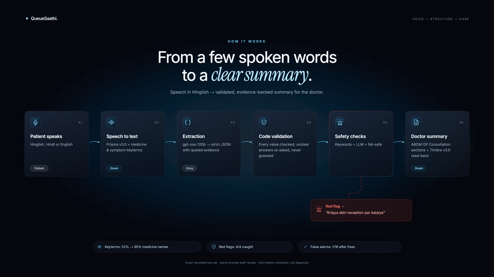

<div align="center">

# QueueSaathi
### Your history, before you walk in.

Voice-first clinic intake in **Hinglish · हिंदी · English**

**[One-page solution pitch](docs/SOLUTION_PITCH.md)** · **[Setup guide](SETUP.md)** · **[How it works](#how-it-works)** · **[Results](#what-we-measured)** · **[Run locally](#run-locally)**

Built for the **Gnani AI Great Indian AI Internship Challenge**

</div>

---

> “BP ki goli leta hoon… naam yaad nahi.”
>
> A few spoken answers can help a doctor understand what brought a patient in—before the consultation begins.

QueueSaathi collects a short history while the patient waits. Patients review what was heard and confirm or correct their medicines. Doctors get a structured summary with quoted evidence and playable recordings. Potential red flags prompt immediate reception review and remain visible in the doctor queue, even when intake stops early.

**It collects information. It does not diagnose or replace the doctor's full history or examination.**

## The experience

| For the patient | For the doctor |
|---|---|
| Choose Hinglish, Hindi or English | Read a concise, code-generated **At a glance** summary |
| Hear questions and answer by voice | See red or amber safety notices first |
| Review the transcript and record again | Review unresolved answers in **Needs attention** |
| Hear medicines read back and confirm or correct them | Check evidence quotes and listen to the original audio |
| Skip irrelevant duration questions for routine, symptom-free visits | Copy a plain-text summary into clinic records |
| Get directed to reception when a safety concern is detected | Find urgent partial intakes at the top of the queue |

Mock sessions are visibly labelled as sample data. Real recognition is available through an explicit live launch.

## How it works



1. **Listen — Prisma v3.0.** Transcribe the recording with medicine keyterms for medicine questions and symptom keyterms for complaint/safety questions.
2. **Structure — gpt-oss-120b via Groq.** Extract question-specific JSON with evidence from the transcript.
3. **Validate — Python.** Check types, ranges and evidence. Invalid fields remain unresolved; an evidence repair can request an exact quote without changing the extracted value.
4. **Check safety.** Combine keyword and LLM findings with negation handling and an uncertainty fail-safe.
5. **Confirm — Timbre v3.0.** Play cached questions and generate medicine read-back for patient confirmation.
6. **Hand over.** Show the doctor the collected fields, unresolved details and supporting words/audio.

The diagram and demo assets are standalone presentation materials, separate from app navigation.

## What we measured

**276 unique scripted recordings · 2 speakers · development evaluation**

| Measure | Result | Scope |
|---|---|---|
| Medicine-name recognition with Prisma keyterms | **52% → 95%** | 30/58 → 55/58 medicine mentions across 40 medicine-test clips |
| Red-flag-positive sessions flagged | **4/4** | Within 20 full scripted sessions |
| False alarms after validation and safety-logic fixes | **11/16 → 1/16** | The same 16 negative sessions, re-evaluated during development |

The 276 recordings comprise **40 medicine clips + 212 full-session question/answer clips + 24 edge-case clips**. The table's measures use different subsets and denominators. Medicine-name recognition does not measure dose/strength correctness. The four positive sessions include repeated scenarios across the two speakers.

These recordings were used to build and refine the prototype. **The results are not an independent clinical evaluation or a guarantee of safety.** The final session evaluation also contains unresolved and incorrect fields; the headline metrics do not describe whole-record accuracy.

One observed transcription error was **“Telma 40” → “Telma H.”** Read-back gives patients a chance to catch such errors; it does not guarantee correction.

**Evidence:** [Medicine results](eval/results/setA_summary.csv) · [Safety-fix comparison](eval/results/PART_A_REPORT_v2.md) · [Latest session results](eval/results/setB_summary_v4.csv)

**Evaluation guides:** [Medicine names / Set A](eval/README.md) · [Full sessions / Set B](eval/setB_README.md) · [Edge cases / Set C](eval/setC_README.md)

## Run locally

### 1. Install dependencies

Requirements: **Python 3.12+**, **Node.js 22.18+**, and npm. Audio conversion uses ffmpeg; the Python dependencies include an `imageio-ffmpeg` fallback. Browser microphone access requires permission.

```sh
git clone https://github.com/clinic-intake-team/Gnani_Hackathon.git
cd Gnani_Hackathon
python3 -m venv .venv
source .venv/bin/activate
python -m pip install -r requirements.txt
npm --prefix web ci
```

Create `.env` from `config/env.example` if you do not already have one:

```sh
cp -n config/env.example .env
```

### 2. Start the app

| Mode | Command | Open |
|---|---|---|
| Single-server build, mock data | `./start.sh --prod` | `http://127.0.0.1:8000` |
| Development with Vite, mock data | `./start.sh` | `http://127.0.0.1:5173` |
| Single-server build, real providers | `./start.sh --prod --live` | `http://127.0.0.1:8000` |

The launcher defaults to **MOCK**. It sets mock/live mode explicitly; live processing requires `--live`. Mock answers are fixed examples rather than recognition of the recording, and mock-generated question audio is silent.

Production mode builds `web/dist` and serves the frontend and API from one FastAPI process. It is a serving mode, not a claim of production security. Both launch modes bind to localhost.

If port 8000 is occupied, choose another port:

```sh
PORT=8020 ./start.sh --prod
```

Then open `http://127.0.0.1:8020`. Stop the server with **Ctrl+C**; refresh alone does not rebuild a production frontend.

### 3. Explore the routes

| Route | Purpose |
|---|---|
| `/` | Project overview and entry points |
| `/intake` | Language selection and patient intake |
| `/intake?kiosk=1` | Patient-only kiosk; resets after completion |
| `/doctor` | PIN-protected queue and evidence-backed summaries |
| `/results` | Evaluation context, versions and limitations |
| `/api/docs` | API documentation in single-server mode |

The demo doctor PIN defaults to **1234** and can be changed through `CLINIC_PIN`. The browser remembers the access token; **Lock** clears it. Developer details are available with `?debug=1`. Mock-data labels remain visible in normal use.

### Live-provider configuration

Keep these settings in your local `.env`:

```dotenv
GNANI_MOCK=1
GNANI_API_KEY=your_gnani_key
LLM_PROVIDER=groq
LLM_MODEL=openai/gpt-oss-120b
GROQ_API_KEY=your_groq_key
LLM_REASONING_EFFORT=medium
CLINIC_PIN=1234
```

A `--live` launch enables real provider requests when patients submit answers. Starting the server itself makes no provider calls. Re-recordings, evidence repairs and changed medicine read-backs can add requests.

**Fixed question audio is cache-only during intake.** If a language's prompts are missing, the text still works, but spoken questions require explicit one-time generation. Inspect the plan first:

```sh
.venv/bin/python scripts/dev.py --preflight
```

Explicit prompt generation uses Timbre credits. Run only for the languages you intend to prepare:

```sh
.venv/bin/python scripts/dev.py --live --prepare-fixed-prompts --prompt-language hinglish
.venv/bin/python scripts/dev.py --live --prepare-fixed-prompts --prompt-language hi
.venv/bin/python scripts/dev.py --live --prepare-fixed-prompts --prompt-language en
```

Each language has 20 fixed prompts; valid cached files are reused. Dynamic medicine read-back is separate. Prisma and LLM caches avoid repeating identical requests; real attempts are logged locally in `logs/`.

## Technology

| Layer | Tools |
|---|---|
| Speech recognition | Gnani AI **Prisma v3.0** |
| Speech synthesis | Gnani AI **Timbre v3.0** |
| Structured extraction | **gpt-oss-120b**, served by Groq |
| Validation and safety | Python, typed field checks, evidence validation, keyword/negation rules |
| Backend | FastAPI |
| Frontend | React, TypeScript, Vite, Tailwind CSS, Framer Motion, Lucide |
| Standalone demo video | Remotion, ffmpeg |

## Project structure

| Folder | Purpose |
|---|---|
| `app/api/` | FastAPI, sessions, intake flow, languages and clinic access |
| `web/` | React interface and frontend build configuration |
| `eval/` | Versioned evaluators, protocols and published results |
| `tests/` | Backend and doctor-summary regression tests |
| `data/` | Question translations, keyterms and ground-truth tables |
| `docs/` | [Solution pitch](docs/SOLUTION_PITCH.md), specifications, handoff and presentation assets |
| `video/` | Standalone Remotion demo and submission compositions |
| `archive/` | Earlier Streamlit prototypes and old example outputs |

The versioned `extract_*` and `redflags_*` files are pipeline layers corresponding to the evaluation versions shown in Results: extraction v3 builds on v2 and v1; safety v3 uses the v3 rules, while `redflags_v2.py` remains for historical evaluation/tests.

The active pipeline stays at the root; the current web app starts through `start.sh`, `start.ps1` or `start.bat`. Setup instructions are in [SETUP.md](SETUP.md).

## Development checks

```sh
source .venv/bin/activate
python -m pip install -r requirements-dev.txt
python -m unittest discover -s tests
npm --prefix web run build
node --test tests/doctor-summary.test.mjs
```

The `node --test` check imports TypeScript directly and needs Node.js 22.18+ or a newer release with built-in TypeScript stripping.

Browser verification scripts live in `scripts/`. Some need a running local server and Playwright/Chrome. Evaluation runners and prompt-generation scripts are separate from these offline checks and should only be run with an understood call budget.

## Clinical basis and deployment limits

The intake draws on selected history-taking concepts and warning signs from:

- [MoHFW/NHM — Training Module for Community Health Officers on Management of Acute Simple Illnesses (December 2022), Chapter 2, Table 1](https://nhsrcindia.org/sites/default/files/2023-04/Supplementary-Module-Book-%28update%29_Print%20Ready%20File.pdf)
- [MedlinePlus — Recognizing medical emergencies](https://medlineplus.gov/ency/article/001927.htm)

The question wording and safety rules are our implementation, not an official translation or endorsement. The intake covers essentials and **does not replace the doctor's full history, examination or emergency assessment**.

Demo uses a simple clinic PIN. A real deployment would use proper staff authentication and encrypted storage. Provider failures, missing evidence and uncertain answers must remain visible for review.

Keep `.env`, provider keys, local session records and private recordings out of commits. The demo's rendered video/audio and imported media are Git-ignored. Review staged files before publishing.

## What's next

Feedback from clinic staff, more speakers and realistic clinic noise, broader Indian-language coverage, and independent clinical validation before real deployment.
